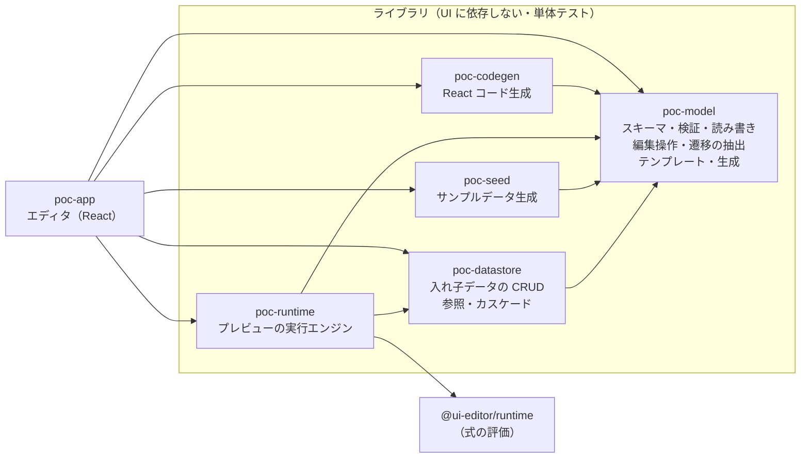

# オリジナル PoC アーキテクチャ

要求仕様 [requirements.html](requirements.html)（draft 0.1）を実装に落とすための構成と決定事項。実装しながら決めたことはここに追記する（最後の「変更履歴」）。

## 1. 前提（要求仕様 13 章の確認結果）

2026-10-23 に確認した結果。要求仕様の推奨案と違うものに ★ を付けた。

| 確認事項           | 決定                                                                                                                                           |
| ------------------ | ---------------------------------------------------------------------------------------------------------------------------------------------- |
| 「クラウド操作」   | CRUD 操作（作成・参照・更新・削除）                                                                                                            |
| 「カスケード構造」 | ★ (B) サンプルデータを親子の入れ子で持つ。D2 は **案 b（入れ子が正）**                                                                         |
| D1 遷移の正        | ★ **案 b（仮の部品を生成）**。遷移はノードのイベントの `navigate` / `openDialog`。遷移を引くと遷移元に仮のボタンを置く                         |
| D3 画面の中身      | 役割（`kind`）ごとのテンプレートから中身を作る。自由編集はステップ 6                                                                           |
| 題材               | 既存の「機器の設定＆モニタリング」                                                                                                             |
| 着手順             | ★ **ER 先行**: ステップ 0 → 3 → 1 → 2 → 4 → 5 → 6                                                                                              |
| ゴール             | ★ **書き出したコードを本番の土台にする**。poc-0 から直接、プレビューと同じ動きをする読みやすい React コードを生成する（ステップ 6 を厚くする） |
| 進め方             | GitHub issue（P0〜P6 と同じ運用。[8 章](#8-作業計画)）                                                                                         |

## 2. 全体構成



| パッケージ                 | パス                              | 責務                                                                                                                                           | 主な依存                                           |
| -------------------------- | --------------------------------- | ---------------------------------------------------------------------------------------------------------------------------------------------- | -------------------------------------------------- |
| `@ui-editor/poc-model`     | `original-poc/packages/model`     | スキーマ poc-0（zod）と型、検証（形・参照・警告）、決定的な読み書き、移行、編集操作、遷移の抽出（フロー図用）、役割テンプレート、ER からの生成 | zod                                                |
| `@ui-editor/poc-datastore` | `original-poc/packages/datastore` | 入れ子のサンプルデータの検索・CRUD、参照（`ref`）の `onDelete`、レコードの検証、id の採番、エンティティごとの平らな一覧（派生）                | poc-model                                          |
| `@ui-editor/poc-seed`      | `original-poc/packages/seed`      | ER からのサンプルデータ生成（件数・シード指定、親子の入れ子、参照の整合、列挙値・型・書式）                                                    | poc-model, @faker-js/faker                         |
| `@ui-editor/poc-runtime`   | `original-poc/packages/runtime`   | プレビューの実行（式の評価、イベント → アクション、画面の履歴とダイアログ、選択、下書き、ログ）                                                | poc-model, poc-datastore, @ui-editor/runtime       |
| `@ui-editor/poc-codegen`   | `original-poc/packages/codegen`   | poc-0 → Vite + React + TS のアプリ（型・データ・ストア・ルーティング・画面・ダイアログ・部品）。決定的・読みやすい・プレビューと同じ動き       | poc-model, prettier, acorn                         |
| `@ui-editor/poc-app`       | `original-poc/app`                | エディタ（ER 図・データ・フロー図・画面・プレビュー・コード書き出し）                                                                          | 上記 + React, @xyflow/react, dagre, zustand, immer |
| —                          | `original-poc/examples`           | 題材「機器の設定＆モニタリング」の poc-0 版（`*.poc.json`）                                                                                    | —                                                  |

要求仕様 11 章のフォルダ構成からの変更:

- `store` → `datastore`。エディタの状態管理（Zustand のストア）と名前がぶつかるため。
- `runtime` を追加。プレビューの実行（遷移・CRUD・ダイアログの重なり）を UI から切り離して単体テストするため（NFR-05）。
- `codegen` を追加。ゴールを「書き出したコードを本番の土台にする」にしたため、v0 経由ではなく poc-0 から直接生成する。P1 の `packages/codegen` の構成（react-router・Zustand・`src/ui/` の部品・Prettier・acorn での式の検査）を下敷きにする。
- パッケージ名は既存に合わせて `@ui-editor/` スコープに `poc-` を付ける。各パッケージは `packages/schema` と同じく `tsc` で `dist/` に出力し、`pnpm -r build` の順序で解決する。
- ワークスペースには `original-poc/packages/*` と `original-poc/app` を登録する（`pnpm-workspace.yaml` の変更はこの 2 行だけ）。
- 開発サーバーのポートは **5180**、生成したアプリの確認用は **5181**（どちらも `strictPort`）。5173〜5179 は既存のプロトタイプが使っている。

## 3. スキーマ poc-0

要求仕様 6 章の案を、確認結果（入れ子が正・遷移はノードのイベント）に合わせて直したもの。zod で形を書き、型は zod から導く。v0 と同じく `strictObject`（未知のキーはエラー）。

```ts
type Id = string; // 画面・ダイアログ・ノード。/^[A-Za-z][A-Za-z0-9_-]*$/
type Identifier = string; // フィールド・state のキー・パラメータ。/^[A-Za-z_][A-Za-z0-9_]*$/
type EntityId = string; // PascalCase。/^[A-Z][A-Za-z0-9]*$/
type Template = string; // `{{ 式 }}` を含みうる文字列
type Scalar = string | number | boolean | null;

interface Project {
  $schema?: string;
  schemaVersion: "poc-0";
  name: string;
  description?: string;
  entry?: Id; // 最初の画面。省略時は screens[0]
  entities: Entity[];
  data: Record<EntityId, DataRecord[]>; // ルートのエンティティだけ。子は親のレコードの中に入れ子で持つ
  state: Record<Identifier, JsonValue>; // 利用者が定義する状態の初期値（selection は予約語）
  screens: Screen[];
  dialogs: Dialog[];
  layout?: Layout; // 見た目だけの情報。ファイルの末尾に書き出す
}

interface Entity {
  id: EntityId;
  name: string; // 表示名（例: 機器）
  primaryKey: Identifier; // type: "id" のフィールド
  displayField?: Identifier; // 参照の選択肢・表示に使う
  fields: Field[];
}

interface Field {
  id: Identifier;
  name?: string; // 表示名
  type: "id" | "string" | "number" | "boolean" | "date" | "enum" | "ref" | "children";
  required?: boolean;
  default?: Scalar;
  values?: string[]; // enum の値
  entity?: EntityId; // ref の参照先 / children の子のエンティティ
  onDelete?: "restrict" | "setNull" | "cascade"; // ref: 参照先が消えたとき（既定 restrict）
  cardinality?: "many" | "one"; // children: 子の配列（既定）か 1 件か
  format?: "email" | "url" | "ipv4" | "phone" | "multiline" | "date" | "datetime";
  min?: number; // number の範囲（生成と検証）
  max?: number;
}

// レコード。children のフィールドには子のレコード（many は配列、one は 1 件か null）が入る
type DataRecord = { [field: Identifier]: Scalar | DataRecord | DataRecord[] };

type Kind = "list" | "detail" | "form" | "confirm";

interface Screen {
  id: Id;
  name: string;
  kind?: Kind; // 役割（D3）
  entity?: EntityId; // 扱うエンティティ
  path?: string; // 例: /devices/:deviceId（省略時は id から作る）
  params?: Record<Identifier, ParamDef>;
  events?: { mount?: Action[] }; // 画面を開いたとき
  root?: Node; // 省略可（中身の無い画面）
}
type Dialog = Omit<Screen, "path" | "events">;

interface ParamDef {
  type: "string" | "number" | "boolean" | "ref";
  entity?: EntityId; // type: "ref" のとき。画面のレコード（record）や入れ子の親を決める
  required?: boolean;
}

interface Layout {
  flow?: Record<Id, { x: number; y: number }>; // フロー図のノード位置
  er?: Record<EntityId, { x: number; y: number }>; // ER 図のノード位置
}
```

### データの例（入れ子）

```json
"data": {
  "Device": [
    {
      "id": "dev-001", "name": "コアスイッチ A", "status": "online", "ipAddress": "192.168.10.1",
      "settings": { "id": "set-001", "dhcp": false, "pollingIntervalSec": 30 },
      "alarms": [{ "id": "alm-001", "level": "warn", "message": "CPU 使用率が高い", "acknowledged": false }]
    }
  ]
}
```

`Device.fields` に `{ "id": "alarms", "type": "children", "entity": "Alarm" }` と `{ "id": "settings", "type": "children", "entity": "DeviceSettings", "cardinality": "one" }` がある。`Alarm` は `data` の直下には現れない。

- 入れ子の親は 1 つだけ（`children` で指される回数は 1 回まで、循環しない）。親を消せば子も消える（カスケード削除が構造で表れる）。
- 入れ子にできない関係（多対多、別の木のレコードを指す）は `ref` フィールド（外部キー）で表し、`onDelete`（restrict / setNull / cascade）に従う。
- 主キーはエンティティの中で一意（親が違っても重複させない）。
- zod では `data` を「エンティティ id → レコード（任意のキー → JSON 値）の配列」とゆるく書き、入れ子の形・型・必須は 2 段階目の検証でエンティティ定義に沿って調べる（`["data", "Device", 0, "alarms", 2, "level"]` のような場所を返すため）。ノードの `props` も同じ。

### ノード（画面の中身）

v0 と同じ形（`id` / `type` / `props` / `style` / `repeat` / `visible` / `events` / `children`）に、仮の部品の印 `placeholder?: true` を足す。組み込みの `type` は v0 の 7 種に `Select` を足す。

| type                        | 主な props                                                                                                             | イベント                                |
| --------------------------- | ---------------------------------------------------------------------------------------------------------------------- | --------------------------------------- |
| `Box`                       | `direction`（`row` / `column`）, `gap`                                                                                 | `click`                                 |
| `Text`                      | `text`, `variant`（`title` / `body` / `caption`）                                                                      | `click`                                 |
| `Button`                    | `label`, `variant`（`primary` / `secondary` / `danger`）, `disabled`, `requires`（例: `selection.Device`。空なら無効） | `click`                                 |
| `TextInput` / `NumberInput` | `label`, `value`, `error`, `disabled`                                                                                  | `change`（`event.value`）               |
| `Checkbox`                  | `label`, `checked`, `disabled`                                                                                         | `change`（`event.value`）               |
| `Select`                    | `label`, `value`, `options`（`{ value, label }[]`）, `error`                                                           | `change`（`event.value`）               |
| `Table`                     | `rows`, `columns`（`{ header, value }[]`）, `entity`, `selectable`                                                     | `rowClick` / `rowSelect`（`event.row`） |

### アクション

どのアクションにも `when?: Template`（偽なら飛ばす）を付けられる（T5 の条件付き遷移など）。

| type           | フィールド                      | 内容                                                                                                                 |
| -------------- | ------------------------------- | -------------------------------------------------------------------------------------------------------------------- |
| `navigate`     | `to`, `params?`                 | 画面遷移（v0 と同じ）。フロー図の線になる                                                                            |
| `openDialog`   | `dialog`, `params?`, `onClose?` | ダイアログを開く。`onClose`（結果 → アクション列）で、閉じた結果ごとに呼び出し元で処理する                           |
| `closeDialog`  | `result?`（既定 `"ok"`）        | 最前面のダイアログを閉じる                                                                                           |
| `back`         | —                               | 前の画面に戻る（ダイアログが開いていれば閉じる）                                                                     |
| `setState`     | `path`, `value`                 | `state` のパスに値を入れる（v0 と同じ）                                                                              |
| `select`       | `entity`, `id`                  | エンティティの選択状態を変える（`null` で解除）                                                                      |
| `createRecord` | `entity`, `values`, `parent?`   | レコードを追加。入れ子のエンティティは `parent`（親の主キー）が必要。id を採番し、必須・型・列挙値・参照先を検査する |
| `updateRecord` | `entity`, `match`, `set`        | `match`（フィールド = 値の AND）に合うレコードを更新（v0 の `updateData` の拡張）                                    |
| `deleteRecord` | `entity`, `match`               | レコードを子ごと削除し、そのレコードを指す `ref` の `onDelete` に従う                                                |
| `setDraft`     | `field`, `value`                | フォームの下書きの項目を変える                                                                                       |
| `saveDraft`    | —                               | フォームの下書きを検証して保存（作成または更新）。エラーは項目ごとに表示し、後続を止める                             |

### 式（`{{ }}`）で参照できる名前

| 名前                  | 内容                                                                                                                                            | 使える場所                      |
| --------------------- | ----------------------------------------------------------------------------------------------------------------------------------------------- | ------------------------------- |
| `data`                | プレビュー中のデータ。ルートは入れ子のまま（`data.Device[0].alarms`）。入れ子のエンティティは全親の子を並べた読み取り専用の一覧（`data.Alarm`） | どこでも                        |
| `state`               | `state` の現在値。`state.selection.<Entity>` は選択中のレコード（無ければ null）                                                                | どこでも                        |
| `params`              | 画面・ダイアログに渡された値                                                                                                                    | 画面・ダイアログの中            |
| `record`              | 画面・ダイアログのレコード（`entity` と同じエンティティの `ref` パラメータで決まる）                                                            | `entity` を持つ画面・ダイアログ |
| `draft` / `errors`    | フォームの下書きと検証エラー（項目 id → メッセージ）                                                                                            | `kind: "form"` の中             |
| `event`               | イベントの値（`event.row` / `event.value`）                                                                                                     | アクションの中                  |
| `row`                 | 表の行                                                                                                                                          | `Table` の `columns[].value`    |
| `repeat.as` / `index` | 繰り返しの要素                                                                                                                                  | `repeat` したノードと子孫       |

## 4. 設計判断

### 4.1 プロジェクト JSON が唯一の正、ビューは投影

ER 図・データ・フロー図・画面・プレビューは、どれもエディタのストアにある 1 つの `Project` を読み、変更は「編集操作」（`poc-model` の `(draft: Project) => void` の関数）だけで行う。ビュー固有の状態（選択中のノード、パネルの開閉）はストアの別の場所に置き、ファイルには書かない。編集操作は UI に依存しないので単体テストする。

### 4.2 データは入れ子が正（D2 の案 b）

- 親子は親のエンティティの `children` フィールドで表し、データは親のレコードの中に子を持つ。エンティティ定義がそのまま JSON の形になる。
- ER 図の線は `children`（入れ子。実線）と `ref`（参照。破線）の 2 種類で、どちらもフィールドから導く（`relations` の配列は持たない）。ER 図で線を引くと、1 対多 / 1 対 1 なら親に `children` を、多対 1 なら子に `ref`（外部キー）を足す（FR-ER-02）。
- 入れ子の弱点（多対多・複数の親）は `ref` で補う。多対多（FR-ER-07）は中間エンティティを片方の親の下に入れ子にし、もう片方を `ref` で指す。
- `poc-datastore` は主キーで木の中の位置（パス）を引けるようにし、更新は位置までの経路だけを作り直す（不変データ）。エンティティごとの平らな一覧はここから派生させる（式の `data.Alarm`、データ画面の表、生成コードのセレクタ）。

### 4.3 遷移はノードのイベント、線を引くと仮の部品（D1 の案 b）

- 遷移の正は、画面・ダイアログの中のノードの `events` にある `navigate` / `openDialog`（と画面の `events.mount`、`openDialog.onClose` の中のもの）。フロー図はこれを抽出して線にする（`extractTransitions`）。
- 線の id は「画面 id・ノード id・イベント名・アクションの位置」から導くだけで、ファイルには保存しない。付随アクションを前に足すと位置がずれるので、フロー図は編集のたびに線を抽出し直し、選択中の線も編集操作が返す新しい id で選び直す。
- フロー図で線を引くと、遷移元の `root` の末尾に仮のボタン（`placeholder: true`、文言は「〈遷移先〉へ」）を置き、その `click` に `navigate`（遷移先がダイアログなら `openDialog`）を書く。`root` が無ければ縦並びの `Box` を作る。
- 遷移パネル（FR-FLOW-04）のトリガー変更は、アクションを別のノード・イベントに移す操作にする（例: 仮のボタンの `click` → 表の `rowClick`）。移した先の部品が無ければ仮の部品を置く: T2（行クリック）・T3（選択＋ボタン）を選んだのに表が無ければ、仮の表（`placeholder: true`、`rows: "{{ data.<エンティティ> }}"`、T3 なら `selectable`）を置く。移した結果イベントが空になった仮の部品は消す。要求仕様が挙げた欠点「トリガーの種類を後から変えにくい」をこの操作で補う。
- T3（選択＋ボタン）はボタンの `requires: "selection.Device"` で表す（未選択なら無効）。
- 線を消すとアクションを消し、空になった仮の部品も消す。
- 警告（FR-FLOW-06）の「部品と結びついていない遷移」は「仮の部品のままの遷移」として出す。

### 4.4 画面の中身（D3）

- 中身は常にノードの木（`root`）。`root` が無い画面は、プレビューでタイトルだけを出す。仮のボタンが置かれた画面はそれ自体がワイヤーフレームになる（FR-RUN-01）。
- 画面に役割（`kind`）とエンティティを設定すると、`poc-model` のテンプレート（一覧 = 表＋操作ボタン、詳細 = 項目＋子の一覧、フォーム = 入力欄＋保存、確認 = 文言＋OK）で `root` を組み立てて書き込む。既にある仮のボタンは操作ボタンの並びに移して残す。仮の部品以外の中身があるときは、上書きする前に差分を示す（FR-GEN-05）。
- テンプレートのノード id は決定的（`title`, `toolbar`, `table` など）。
- 入れ子のエンティティ（例: `Alarm`）は親が無いと作れないので、「追加」の入口は親の詳細画面の子の一覧に置く。入れ子のエンティティの一覧画面（全機器のアラーム一覧など）は参照・選択・編集・削除だけにする（ステップ 5 の生成もこれに従う）。

### 4.5 選択状態と下書き

- `state.selection` は予約語。プレビューのランタイムがエンティティごとに選択中のレコードの **id** を持ち、式からは `state.selection.Device` でレコードそのもの（削除されたら null）が見える。ファイルの `state` に `selection` は書かない。
- フォームの下書きは、開いている画面・ダイアログ（フレーム）ごとに持つ。開いたときに `record` があれば複製（編集）、無ければ既定値（作成）で作り、閉じれば捨てる（FR-DATA-03）。入れ子のエンティティを作るフォームは、親のエンティティの `ref` パラメータで親を決める。

### 4.6 式の評価は `@ui-editor/runtime` を使う

`{{ }}` は P4 の `evaluateTemplate` / `resolveValue` で評価する（TypeScript のパーサーで式を検査してから `new Function`。NFR-06 の「JS として評価、信頼できるファイルだけ」に合う）。TypeScript がブラウザのバンドルに入る（約 3.5 MB）が、`apps/runtime-preview` と同じく許容する。生成コードでは式を TS の式としてそのまま埋め込む（P1 と同じ）。

### 4.7 id の付け方

id は人が読める連番（`screen1`, `dialog1`, `btn1`, `Entity1`）にし、乱数は使わない（決定的な書き出し・git の差分のため）。パネルで id を変えると、参照（`navigate.to`、`openDialog.dialog`、`entry`、`ref` / `children` の `entity`、`layout` など）も書き換える。式の中の参照（`data.Device` など）は書き換えず、検証で指摘する。

### 4.8 配置情報は同じファイルの `layout` キー

FR-FLOW-02 の「別ファイル、または別キー」のうち別キーを採る。File System Access API で 1 ファイルを開いて上書きするだけで済み（NFR-01）、書き出しで末尾に置くので git の差分でも本体と分かれる（NFR-02）。コード生成では使わない。

### 4.9 検証は 2 段階 ＋ 重大度

1. 形: zod。失敗したら読み込まない（場所付きで表示）。
2. 参照・整合性: id の重複・存在、ER の整合（主キー、`children` が木になっているか、`ref` の参照先）、データの整合（入れ子の形、主キーの重複、必須、型、列挙値、参照先の存在）、アクション（遷移先、エンティティ・フィールド、パラメータ）、`{{ }}` の対応。**`error`**（壊れている）と **`warning`**（到達できない画面・仮の部品のままの遷移・呼ばれないダイアログなど、作りかけで普通に起きるもの）を分ける。読み込みは止めない。

問題には `path`（例: `["screens", 1, "root", "children", 2, "events", "click", 0, "to"]`）を付け、検証パネルから該当の画面・エンティティ・データを選べるようにする。

### 4.10 決定的な書き出し

v0 の `serializeProject` と同じ方針。キーを固定の順（`schemaVersion`, `id`, `type`, `name`, … を先頭、`root` / `children` / `data` / `layout` を末尾、ほかはアルファベット順）に並べ、`undefined` は書かない。`data` のレコードはエンティティのフィールド順に並べる（入れ子の中も）。`layout` は id 順・座標は整数。配列の順序は変えない。整形は `JSON.stringify(v, null, 2)`（Prettier の対象から外す）。

### 4.11 バージョンと移行

`schemaVersion: "poc-0"`。`migrate(raw)` を読み込みの最初に通す（今は poc-0 をそのまま返すだけ）。PoC の途中で足すのは省略可能なキーだけにして poc-0 のまま進め、互換が崩れる変更をするときは `poc-1` にして移行関数とテストを足す（NFR-03）。

### 4.12 コード生成（本番の土台）

- `poc-codegen` の `generate(project) → { path, content }[]` は純粋関数。CLI とエディタ（File System Access API でフォルダに書き出す）の両方から使う。
- 生成するアプリ: Vite + React + TS、react-router（1 画面 = 1 ルート）、Zustand のストア（データ・state・選択・ダイアログ）、`src/ui/` の部品、CSS Modules。P1 の命名と構成を引き継ぐ。
- ER から型（`interface Device { …; alarms: Alarm[] }`）、データ操作（エンティティごとの `createAlarm(parentId, values)` などの型付き関数。入れ子の位置探し・カスケード・参照の `onDelete`・検証）を生成する。データの取得元を API に差し替えるときの境目はストアの 1 か所にまとめる。
- 画面・ダイアログはノードの木を JSX に、アクションを型付きの関数呼び出しに変換する。フォームの下書きはコンポーネントの state、検証は ER から生成した関数。
- 生成アプリは `strictNullChecks` を有効にする（P1 は手書きの式が null を考慮していなかったため外した）。そのため、テンプレートと ER からの生成（ステップ 4・5）が書く式は最初から null を考慮する（`record?.name`、`state.selection.Device?.id`）。
- 決定的（Prettier で整形、依存の版はコード内に固定、日時や絶対パスを出さない）。生成物は `tsc` が通ること、題材の生成結果のスナップショット、そして **プレビューと同じ QA の筋書きが生成アプリでも通ること** をテストする。

### 4.13 Undo / Redo

Zustand のストアで、編集操作を immer の `produceWithPatches` に通し、逆パッチを履歴に積む（FR-PRJ-04）。ノードのドラッグは途中経過を履歴に積まず、ドラッグ終了の 1 回だけを積む。プレビューの状態は履歴に含めない。immer・zustand はロックファイルにある版（immer 9.0.21・zustand 5.0.15）を使う。

### 4.14 保存

- 開く・上書き保存・名前を付けて保存は File System Access API。無いブラウザはファイル選択とダウンロード（NFR-01）。
- 自動保存（FR-PRJ-05）は localStorage。編集のたびに少し待ってから書き、起動時に残っていれば復元する。
- ファイルを読むときは `migrate` → 形の検証 → 参照の検証。形が壊れていれば読み込まずに問題を表示する。

## 5. エディタ（poc-app）の構成

```
┌ ヘッダー: プロジェクト名 | 新規・開く・保存・名前を付けて保存・例を開く | Undo・Redo | 検証（エラー n / 警告 m）| プレビュー | コード書き出し ┐
├ ビュー切替 ─┬ メイン（ER 図 / データ / フロー図 / 画面）───────────────┬ インスペクタ ─┬ プレビュー（開閉）┤
│ ER           │ React Flow など                                         │ 選んだものの   │ 実行中の画面      │
│ データ       │                                                         │ 編集パネル     │ ダイアログ・ログ  │
│ フロー       │                                                         │                │                   │
│ 画面         │                                                         │                │                   │
└──────────────┴─────────────────────────────────────────────────────────┴────────────────┴───────────────────┘
```

- `src/state/` … Zustand のストア（`project`、履歴、ファイルのハンドル、未保存フラグ、ビューの選択、プレビューのランタイムの状態）。変更は `edit(label, recipe)` だけ。
- `src/views/er/` … ER 図（エンティティ・属性・入れ子と参照の線、IE 記法の線端）。
- `src/views/data/` … サンプルデータ（生成、入れ子の木と表での編集、参照は表示名で選ぶ）。
- `src/views/flow/` … フロー図（画面・ダイアログ一覧、ノード、線を引く＝仮のボタン、自動レイアウト、遷移パネル、入出力の一覧、警告）。
- `src/views/screen/` … 画面の中身（役割・エンティティの設定とテンプレート、部品の編集、バインディング）。
- `src/preview/` … ノードの描画、ダイアログの重ね表示、ログ。フロー図に現在地と経路を出すため、ランタイムの状態はストアに置く。

## 6. プレビューの実行モデル（poc-runtime）

```ts
interface RuntimeState {
  data: Dataset; // サンプルデータの複製（元のサンプルデータは書き換えない）
  state: Record<string, JsonValue>;
  selection: Record<EntityId, string | null>;
  history: Frame[]; // 画面の履歴（最後が今の画面）
  dialogs: Frame[]; // 開いているダイアログ（最後が最前面）
  trail: TransitionRef[]; // たどった遷移（フロー図の強調用）
}
interface Frame {
  container: Id;
  params: Record<string, unknown>;
  draft?: Record<string, Scalar>;
  errors?: Record<string, string>;
  onClose?: Record<string, Action[]>; // 開いた openDialog の onClose
}
```

- すべて純粋関数: `start(project)`、`fireEvent(project, rt, target, event)`、`resetData(project, rt)` などが新しい `RuntimeState` とログを返す。
- イベントのアクションは順に実行し、失敗したら（検証エラー、restrict の削除など）残りを実行しない。各アクションは直前のアクションの結果を見て評価する（保存 → 閉じる → 遷移）。
- `navigate` は開いているダイアログを閉じてから移り、履歴に同じ画面があればそこまで戻す（「一覧に戻る」で履歴が伸び続けないように）。移った先の `mount` を実行する。
- CRUD は `poc-datastore` に任せ、結果（追加・更新・削除・カスケードで消えたもの）をログに残す（FR-RUN-06）。

## 7. テストと QA

- **ライブラリ**: Vitest の単体テスト。読み込み → 書き出し → 再読み込みの往復、参照エラーの場所、入れ子の CRUD とカスケード、シード固定の生成、ランタイムの遷移・ダイアログ・CRUD の筋書き、生成コードのスナップショットと `tsc`。
- **エディタ**: ストアの編集操作と Undo / Redo はテストする。画面部品は必要なものだけ Testing Library で確かめる。
- **QA（ステップごとの完了条件の確認）**: 各ステップの最後の作業で、完了条件の操作を playwright-core とインストール済みの Chrome で自動操作するスクリプト（`app/qa/step<N>.mjs`）を作り、`vite build` → `vite preview`（ポート 5180）に対して実行する。スクリーンショットを撮って目でも確かめ、結果を issue にコメントする。ステップ 6 では同じ筋書きを生成したアプリ（ポート 5181）にも流す。

## 8. 作業計画

親 issue は #72、ステップごとの issue は #73（ステップ 0）〜 #79（ステップ 6）。1 issue = 1 コミット = 1 PR。ブランチは `ysksm/op<ステップ>-<番号>`（例: `ysksm/op0-1`）を最新の main から作り、`Closes #<issue>` を書いた PR を squash マージしてから次に進む。`pnpm -r build && pnpm -r test && pnpm lint && pnpm format:check` が通ることを各 PR の条件にする。

| 順  | ステップ                           | 作業                                                                                                                                                                                                        |
| --- | ---------------------------------- | ----------------------------------------------------------------------------------------------------------------------------------------------------------------------------------------------------------- |
| 1   | 0 スキーマと検証・保存             | 0-1 アーキテクチャ文書 / 0-2 model パッケージとスキーマ（形） / 0-3 参照の検証 / 0-4 読み書き・移行・題材サンプル                                                                                           |
| 2   | 3 ER 図とサンプルデータ（ER 先行） | 3-1 datastore / 3-2 seed / 3-3 エディタの土台（ストア・Undo/Redo・ファイル・自動保存・検証パネル） / 3-4 ER 編集と ER 図 / 3-5 データの編集・生成・入れ子表示 / 3-6 QA                                      |
| 3   | 1 画面一覧とフロー図               | 1-1 画面・ダイアログ一覧 / 1-2 フロー図（線を引く＝仮の部品、自動レイアウト） / 1-3 QA                                                                                                                      |
| 4   | 2 トリガーとワイヤーフレーム       | 2-1 runtime（遷移・ダイアログ） / 2-2 遷移パネルと入出力一覧 / 2-3 警告 / 2-4 プレビューと現在地の強調 / 2-5 QA                                                                                             |
| 5   | 4 データのバインドと CRUD          | 4-1 役割テンプレート / 4-2 runtime の CRUD・選択・下書き / 4-3 プレビューでの CRUD・ログ・リセット / 4-4 QA                                                                                                 |
| 6   | 5 ER からの画面・遷移の生成        | 5-1 生成ロジック / 5-2 生成 UI と後付け / 5-3 影響の表示 / 5-4 QA                                                                                                                                           |
| 7   | 6 画面の編集とコード書き出し       | 6-1 部品の編集 / 6-2 バインディングの補完と仮の部品の置き換え / 6-3 codegen: 型・データ・ストア / 6-4 codegen: 画面・ダイアログ・ルーティング / 6-5 エディタからの書き出し / 6-6 生成アプリの QA と評価メモ |

v0 形式への書き出し（FR-PRJ-06、Should）は、コード生成を poc-0 から直接行うことにしたので優先度を下げ、最後に余裕があれば行う。

## 9. 要求仕様からの差分（まとめ）

- 確認結果により D1 は案 b、D2 は案 b、着手は ER 先行、ゴールはコードを本番の土台に（1 章）。
- パッケージ: `store` → `datastore`、`runtime` と `codegen` を追加、`@ui-editor/poc-*` の名前（2 章）。
- `relations` の配列と `transitions` の配列は持たない。関係は `children` / `ref` フィールド、遷移はノードのイベントから導く。
- `state.selection` は予約語で、ランタイムが id を持つ（4.5）。フォームの下書きはフレームごと。
- アクションに `select` / `setDraft` / `saveDraft` / `when` / `openDialog.onClose` を追加。`updateRecord` / `deleteRecord` は `match`、`createRecord` は入れ子のとき `parent` で対象を指定する。
- ノードに `placeholder`、`Button` に `requires`、組み込みに `Select` を追加。
- フィールドに `name` / `format` / `min` / `max` / `onDelete` / `cardinality` を追加。

## 変更履歴

- 2026-10-23 初版（要求仕様 13 章の確認結果を反映）
