# 使い方の手順（Original PoC）

空のプロジェクトから「機器と、機器ごとのアラームを管理するアプリ」を作り、コードとして書き出すまでを 1 手ずつ説明する。準備と起動は [はじめかた](getting-started.md) を先に読む。

かかる時間はおよそ 15 分。流れは次のとおり。

```text
ER（データの形） → データ（サンプル） → 画面を生成 → フロー（遷移） → 画面（中身） → プレビュー → 保存・書き出し
```

スクリーンショットは `pnpm --filter @ui-editor/poc-app guide:shots` で撮り直せる（この手順と同じ操作をする）。

## 0. 画面の見方

起動すると題材（機器の設定＆モニタリング）が開く。下の図はフロービューとプレビューを並べたところ。

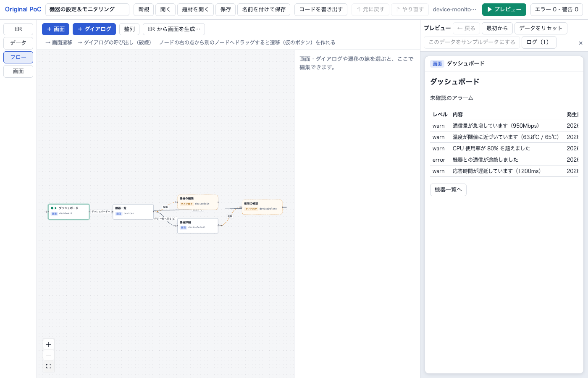

| 場所             | 中身                                                                                                                           |
| ---------------- | ------------------------------------------------------------------------------------------------------------------------------ |
| 上のヘッダー     | プロジェクト名、新規・開く・題材を開く・保存・名前を付けて保存、コードを書き出す、元に戻す／やり直す、▶ プレビュー、検証の件数 |
| ヘッダーの下     | お知らせ（操作の結果やエラー）。右の × で閉じる                                                                                |
| 左の縦の切り替え | **ER**・**データ**・**フロー**・**画面** の 4 つのビュー                                                                       |
| 右（開いたとき） | プレビュー。作っているアプリを動かす。どのビューとも並べて使える                                                               |

- 作業はブラウザに自動で保存され、次に開くと続きから始まる。
- 間違えたら **元に戻す**（Cmd/Ctrl + Z）。**やり直す** は Shift + Cmd/Ctrl + Z。

## 1. 新しいプロジェクトを作る

1. ヘッダーの **「新規」** を押す（保存していない変更があれば、消してよいか確かめられる）。
2. ヘッダー左の名前欄に `機器の管理` と入れて Enter。

## 2. ER: データの形を決める

左の **ER** を押す。

### 2-1. エンティティ「機器」を作る

1. **「＋ エンティティ」** を押す。右のパネルに新しいエンティティが出る。
2. パネルの **名前** に `機器`、**id** に `Device` と入れる（id はコードの名前になるので英字）。
3. **「＋ 属性」** で属性を足し、各行に id・名前・型を入れる:
   - `name`・名前・**文字列**・**必須** にチェック
   - `status`・状態・**列挙**。下の欄に値を `online, offline` のようにカンマ区切りで入れる
4. **表示用** で「名前（name）」を選ぶ（一覧や選択肢でレコードを表す項目）。

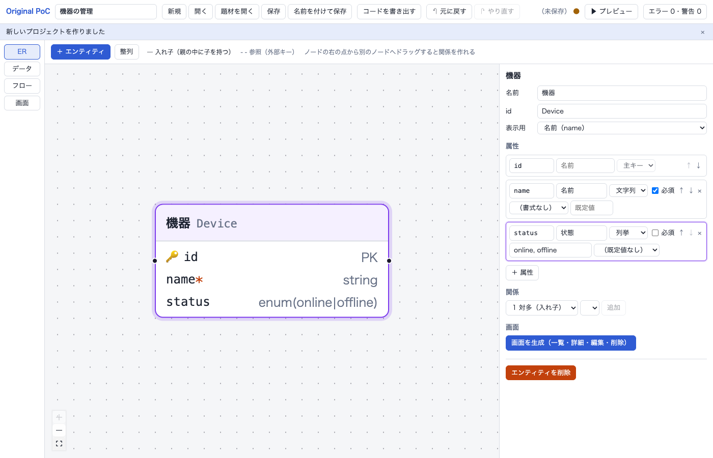

`id` 属性（主キー）は自動で付く。属性の行の ↑↓ で並べ替え、× で消す。

### 2-2. エンティティ「アラーム」を作り、機器の中に入れる

1. 同じように **「＋ エンティティ」** で `アラーム`（`Alarm`）を作る:
   - `level`・レベル・列挙（`info, warn, error`）・必須
   - `message`・内容・文字列・必須
   - 表示用は「内容（message）」
2. ER 図で **機器** のノードを押して選ぶ。
3. パネルの **関係** で「1 対多（入れ子）」と「アラーム（Alarm）」を選び、**「追加」**。

機器に `alarms` 属性ができ、図に線が引かれる（機器 1 件の中にアラームが 0 件以上ある）。

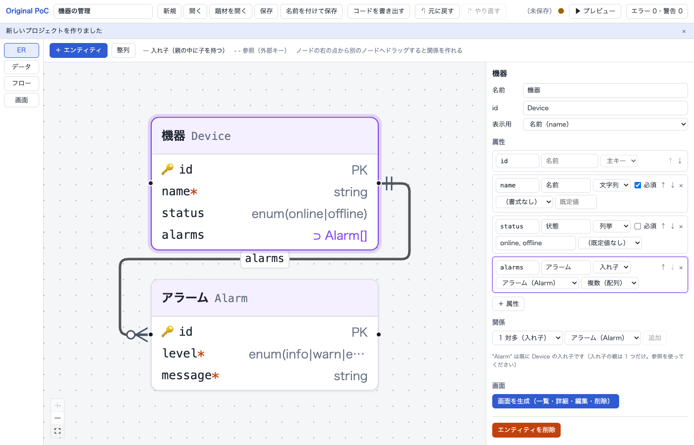

関係は、ノードの右の点から別のノードへドラッグしても作れる（種類を選ぶダイアログが出る）。

| 関係の種類       | 意味                                         | 図の線 |
| ---------------- | -------------------------------------------- | ------ |
| 1 対多（入れ子） | 親の中に子を複数持つ（親を消すと子も消える） | 実線   |
| 1 対 1（入れ子） | 親の中に子を 1 つ持つ                        | 実線   |
| 多対 1（参照）   | 別のエンティティを id で指す（外部キー）     | 破線   |

ノードが重なったら、ツールバーの **「整列」** で並べ直す。

## 3. データ: サンプルデータを作る

左の **データ** を押す。

1. **「サンプルデータを生成…」** を押す。
2. 件数を入れる（例: 機器 5、アラーム 12。入れ子のアラームは全部の機器の合計）。シードを変えると別の値になる。
3. **「生成して置き換える」**。

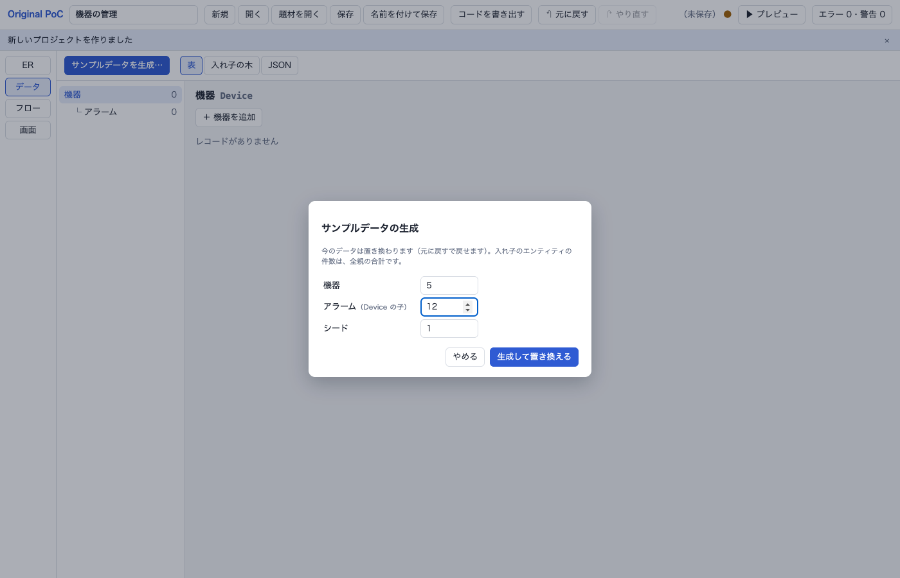

左のエンティティを選ぶと表が出る。セルを直接書き換えられる。行の追加は「＋ 機器を追加」、削除は行の「削除」（入れ子のアラームも一緒に消える）。

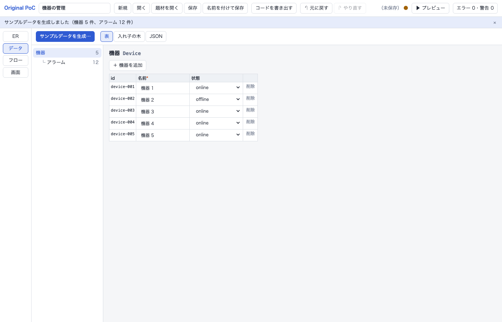

- **入れ子の木**: 機器からアラームをたどって見る。
- **JSON**: 保存される形のデータを見る・書き出す。

## 4. 画面を生成する

1. 左の **ER** に戻り、**機器** を選ぶ。
2. パネルの **「画面を生成（一覧・詳細・編集・削除）」** を押す。
   機器一覧・機器詳細・機器の編集（ダイアログ）・機器の削除（確認ダイアログ）と、その間の遷移ができる。
3. **アラーム** を選んで、同じく **「画面を生成」**。
   アラームの画面ができ、機器詳細に「アラームを追加」ボタンが付く。

パネルの「画面」に、そのエンティティを扱う画面が並ぶ。押すと画面ビューで開く。

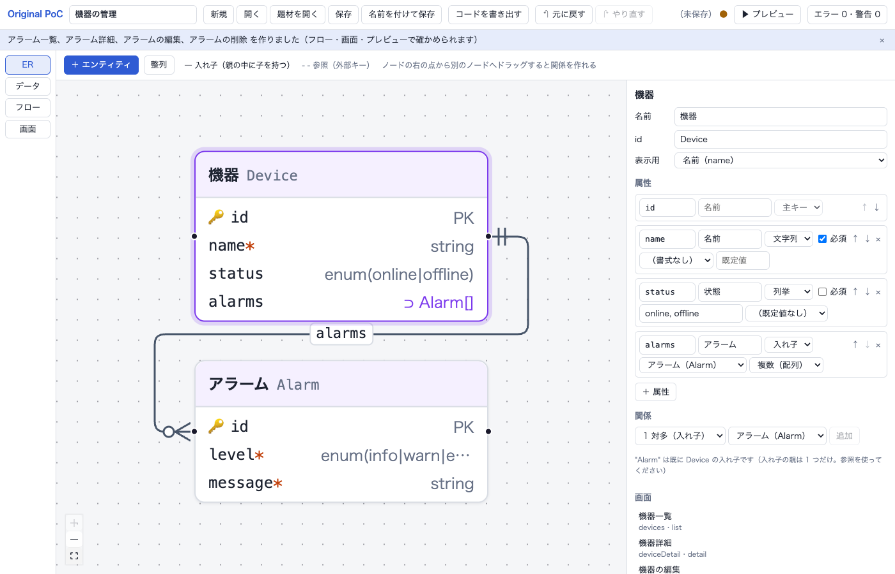

## 5. フロー: 画面のつながりを見る・足す

左の **フロー** を押し、**「整列」** で全体を並べる。

| 図の要素         | 意味                                         |
| ---------------- | -------------------------------------------- |
| 四角             | 画面（▶ が付いているのが最初の画面）         |
| 角の丸い破線の枠 | ダイアログ                                   |
| 実線             | 画面の遷移                                   |
| 破線             | ダイアログを開く                             |
| 点線             | ダイアログを閉じたあとの遷移                 |
| 線のラベル       | 何を押すと移るか（ボタンの文言・行クリック） |

### 遷移を足す

例: 機器詳細からアラーム一覧へ移るボタンを作る。

1. **機器詳細** のノードの右の点から、**アラーム一覧** のノードへドラッグする。
2. 遷移ができ、機器詳細に **仮のボタン**「アラーム一覧へ」が置かれる。右のパネルにその遷移が出る。

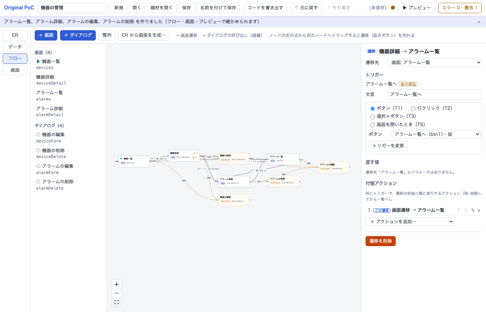

遷移のパネルでは次を変えられる。

- **遷移先**
- **トリガー**: ボタン（T1）・行クリック（T2）・選択＋ボタン（T3）・画面を開いたとき（T5）
- **文言**: ボタンの文字
- **渡す値**: 遷移先のパラメータ（例: 機器の id）
- **付随アクション**: 同じボタンで、遷移の前後にする処理（例: 削除してから一覧へ）
- **遷移を削除**

画面やダイアログを手で作るときは **「＋ 画面」「＋ ダイアログ」**。

### 検証の警告を見る

仮のボタンのままの遷移は **警告** になり、ヘッダー右の件数が「警告 1」になる。件数を押すと下に検証の結果が出る。行を押すと、問題の場所を開く。

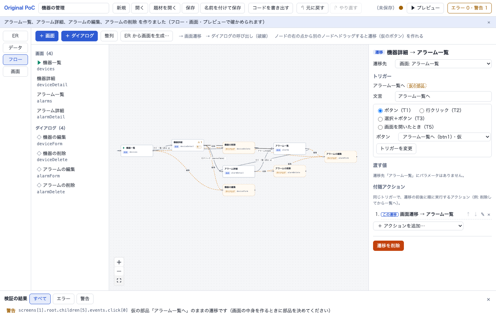

警告があっても動かしたり書き出したりできる。**エラー** があるとコードを書き出せない。

## 6. 画面: 中身を直す

左の **画面** を押し、一覧から **機器詳細** を選ぶ。

| 列                     | 中身                                                           |
| ---------------------- | -------------------------------------------------------------- |
| 中身（ノードの木）     | 画面の部品の入れ子。橙の「仮」は仮の部品                       |
| 部品のパネル（真ん中） | 選んだ部品の文言・見た目・表示条件・遷移・イベントのアクション |
| この画面のプレビュー   | この画面だけを動かす。上の選択で見本のレコードを変える         |

上の **役割** と **エンティティ** を選んで **「テンプレートを適用」** すると、中身を作り直せる（仮の部品は残る）。

### 6-1. 部品を足す

1. 中身の木で `toolbar`（ボタンの並び）を押して選ぶ。
2. **「＋ 部品を追加…」** から **Button** を選ぶ。選んだ Box の中に足される。
3. パネルの **文言** に `全アラームを見る` と入れて Enter。

パネル右上の ↑↓ で並べ替え、× で消す。

### 6-2. データを表示する（バインディング）

1. 中身の木で `page` を選び、**「＋ 部品を追加…」** から **Text** を足す。
2. 文言に `アラーム件数: {{ (record?.alarms ?? []).length }}` と入れて Enter。

`{{ }}` の中は式。欄に入力すると、その画面で使える名前の候補（`record?.name`、`params.deviceId` など）が出る。右の「この画面のプレビュー」にすぐ反映される。

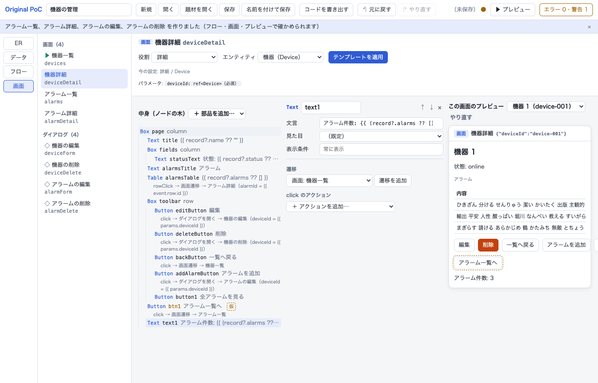

| 式で使える名前の例 | 中身                                           |
| ------------------ | ---------------------------------------------- |
| `record`           | この画面で開いているレコード（詳細・フォーム） |
| `params`           | 画面に渡された値（`params.deviceId`）          |
| `data.Device`      | 機器の全レコード                               |
| `draft`            | フォームで入力中の値                           |
| `row`              | 表の列の中の、その行のレコード                 |

null かもしれない値は `record?.name` のように `?.` を付ける（書き出したコードの型の検査で引っかかる）。

### 6-3. 仮のボタンの遷移を、足したボタンに移す

1. 中身の木で、足したボタン（`button1`）を選ぶ。
2. パネルの **遷移** に「仮の部品の遷移」が出る。**「この部品に移す」** を押す。

仮のボタン「アラーム一覧へ」が消え、足したボタンで移るようになる。警告も 0 になる。

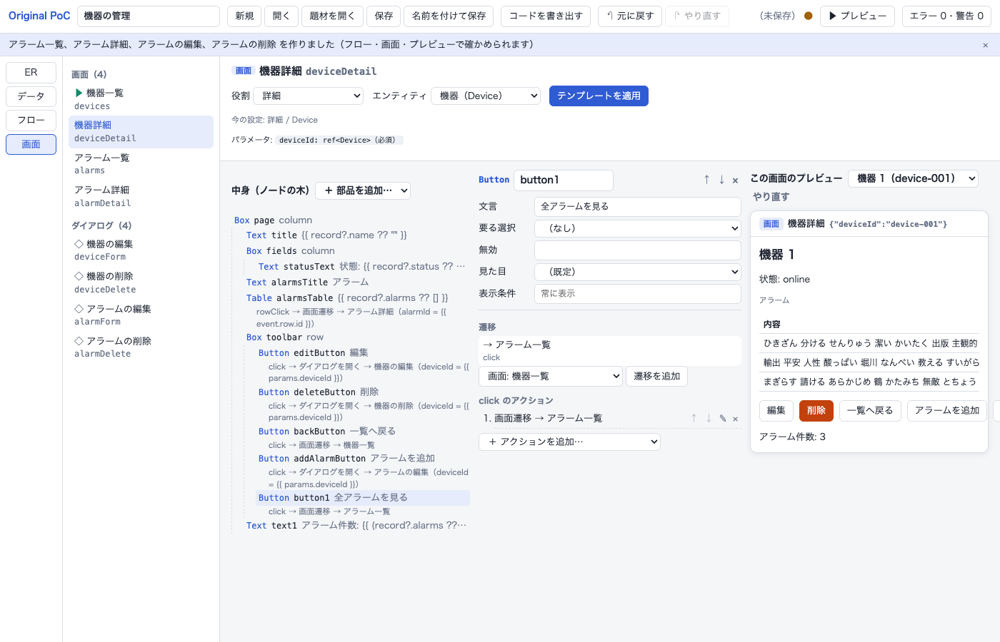

新しい遷移を部品から直接作るときは、パネルの「遷移」で遷移先を選んで **「遷移を追加」**。

## 7. プレビュー: 動かして確かめる

ヘッダーの **「▶ プレビュー」** を押す。最初の画面（機器一覧）から動く。フロー図と並べると、今いる画面が緑の枠で、たどった遷移が緑の線で光る。

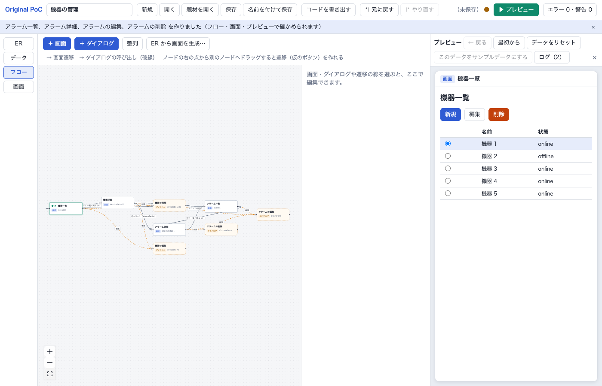

試すこと:

1. 行のラジオで機器を選び **「編集」** → 名前を変えて **「保存」** → 一覧に反映される
2. 行を押す → 機器詳細。**「全アラームを見る」** → アラーム一覧。**「← 戻る」** で戻る
3. 詳細で **「アラームを追加」** → 入れて保存 → 件数が増える
4. 詳細で **「削除」** → 確認で **「削除する」** → 一覧に戻る（アラームも消える）

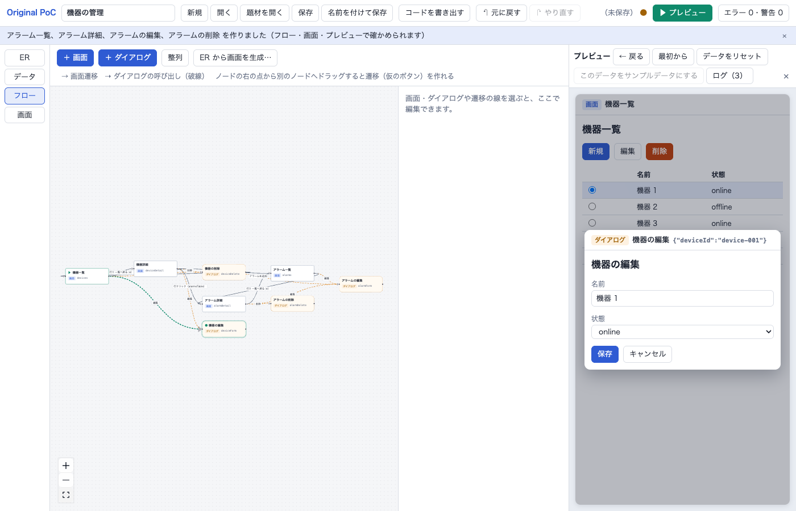

| ボタン                           | はたらき                                                       |
| -------------------------------- | -------------------------------------------------------------- |
| ← 戻る                           | 前の画面へ（ダイアログが開いていれば閉じる）                   |
| 最初から                         | 最初の画面からやり直す                                         |
| データをリセット                 | プレビューで変えたデータを、元のサンプルデータに戻す           |
| このデータをサンプルデータにする | プレビューで変えたデータを、プロジェクトのサンプルデータにする |
| ログ                             | 実行したアクションとデータの変化                               |

プレビューで変えたデータは、サンプルデータを書き換えない（「このデータをサンプルデータにする」を押したときだけ）。

## 8. 保存する・開く

- **保存**（Cmd/Ctrl + S）: 保存先を選んで `*.poc.json` に保存する（最初の名前は `project.poc.json`。書き出すアプリの名前はこのファイル名から作るので、`device-admin.poc.json` のような英字の名前にするとよい）。2 回目からは同じファイルに上書きする。
- **名前を付けて保存**（Shift + Cmd/Ctrl + S）: 別のファイルに保存する。
- **開く**: `*.poc.json` を開く。
- **題材を開く**: 見本のプロジェクト（機器の設定＆モニタリング）を開く。

ヘッダーの「（未保存）●」は、ファイルに保存していない変更があるしるし。

## 9. コードを書き出す

1. ヘッダーの **「コードを書き出す」** を押す。
   - Chrome / Edge: 書き出すフォルダを選ぶ。リポジトリの外に空のフォルダを作って選ぶとよい。
   - それ以外のブラウザ: zip がダウンロードされるので展開する。
   - 検証のエラーや式の誤りがあると、場所付きの理由がお知らせに出て、書き出さない。
2. 書き出したフォルダで:

```sh
pnpm install
pnpm dev      # http://localhost:5181/
```

プレビューと同じように動くアプリ（Vite + React + TypeScript）が開く。`pnpm build` で型の検査とビルドをする。中身の説明は、書き出したフォルダの `README.md` にある。

## 10. 困ったとき

| 症状                                     | 対処                                                                                |
| ---------------------------------------- | ----------------------------------------------------------------------------------- |
| 操作を間違えた                           | 元に戻す（Cmd/Ctrl + Z）                                                            |
| 図のノードが重なって見にくい             | 「整列」。図の左下の ⛶ で全体が入るように合わせる                                   |
| 「部品を追加」した場所が思ったのと違う   | 先に入れたい Box を選ぶ。Box 以外を選んでいると、その後ろに足される                 |
| プレビューが思った画面から始まらない     | フローで画面を選び、パネルの「最初の画面にする」を押す                              |
| プレビューで「〜は削除されました」と出る | 「最初から」を押す                                                                  |
| プレビューの文言に ⚠ が出る              | 式の誤り。⚠ にポインタを当てると理由が出る。画面ビューでその部品の式を直す          |
| 「コードを書き出す」でエラー             | お知らせの場所（例: `画面 deviceDetail / page / title / props: …`）の式や部品を直す |

起動やポートの問題は [はじめかた](getting-started.md#うまくいかないとき)。ビューごとの細かい操作は [エディタの README](../app/README.md)。
